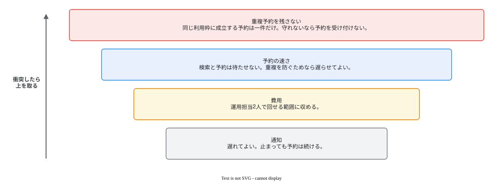

# 非機能要件の見本（抜粋）

この見本は、非機能要件の資料で判断が分かれやすい箇所だけを、会議室の予約サービスの題材から抜き出したものである。題材の値や言い回しは写さず、どこで何を判断したかを見る。節の構成はテンプレートが持つ。

## 守る順位を、題名のすぐ下で図にする

性質どうしが衝突したときにどちらを取るかで、構成と試験の判断の大半が決まる。そこで順位を最初の図にし、本文で譲るものを言い切った。順位が決まっていない題材なら、図を描かずに、決まっていない衝突として問う。

> 最優先で守るのは、同じ利用枠に成立する予約を一件だけにすることである。これを守れないときは、古い空き状況で予約を成立させるより、予約を受け付けないほうを選ぶ。通知は遅れてよく、止まっても予約は続ける。

## 平均は式と時間窓を書き、ピークは別の根拠で置く

平均は月の総量を、暦の時間ではなく活動時間で割ったので、その式と仮定を書いた。ピークは平均に一般の倍率を掛けず、電話台帳と聞き取りから置いた推定にした。ピークの根拠が無い題材なら、ピークを作らず「まだ決まっていない値」に置く。

| 項目 | 値 | 出し方 |
|---|---|---|
| 検索の平均 | 毎秒15件 | 月150万件 ÷ 活動時間10万秒（25営業日 × 4,000秒と仮定） |
| 検索の1分ピーク | 毎秒120件 | 電話台帳と聞き取りからの推定 |
| 通知の配信 | 毎秒60件 | 一件の予約の変化が二人へ届く。通知先が二人であることは決めた値、率は推定 |

> どれも実測ではない。公開後の最初の1か月で、1分ごとの検索の件数を測って見直す。

## 一つの操作から膨らむ負荷は、操作の数と分けて書く

通知は、操作の数は少なくても、一件の変化が二か所へ届く。利用者ごとの操作の上限では抑えられないので、到着率とは別に、配信先の数として書いた。利用者の数を縮めても、一つの操作あたりの配信先の数は縮まない。

## 同じ具体の値でも、決めた人がいなければ仮置きと書く

重複予約を残さないことは事業責任者が決めたので、言い切った。「検索の95%を800ミリ秒以内」は、測る場所、統計量、時間窓まで揃っているが、決める人の合意が無いので仮置きと書いた。値が具体的でも、合意が無ければ目標として確定しない。

> 検索は、上のピークを10分間与えたとき、95%を800ミリ秒以内に返す。運用責任者の合意を待つ仮置きの値である。

## 話に出なかった性質も、関係するかで評価する

可用性は依頼で話題にならなかったが、予約の成立が止まれば利用者は会議室を使えない。関係はあり、答えが無いので「まだ決まっていない値」に置いた。話に出なかったことは、関係しない理由にならない。

## 容量を見積もる期間と、記録を残す期限を分ける

> 容量は7年分で見積もる。これは計算の仮定で、予約の記録を何年残すかは法務の確認が済むまで決めない。予約者の一覧からは、利用日の翌月末を過ぎた予約を外す。一覧から外すことは、消すことではない。
